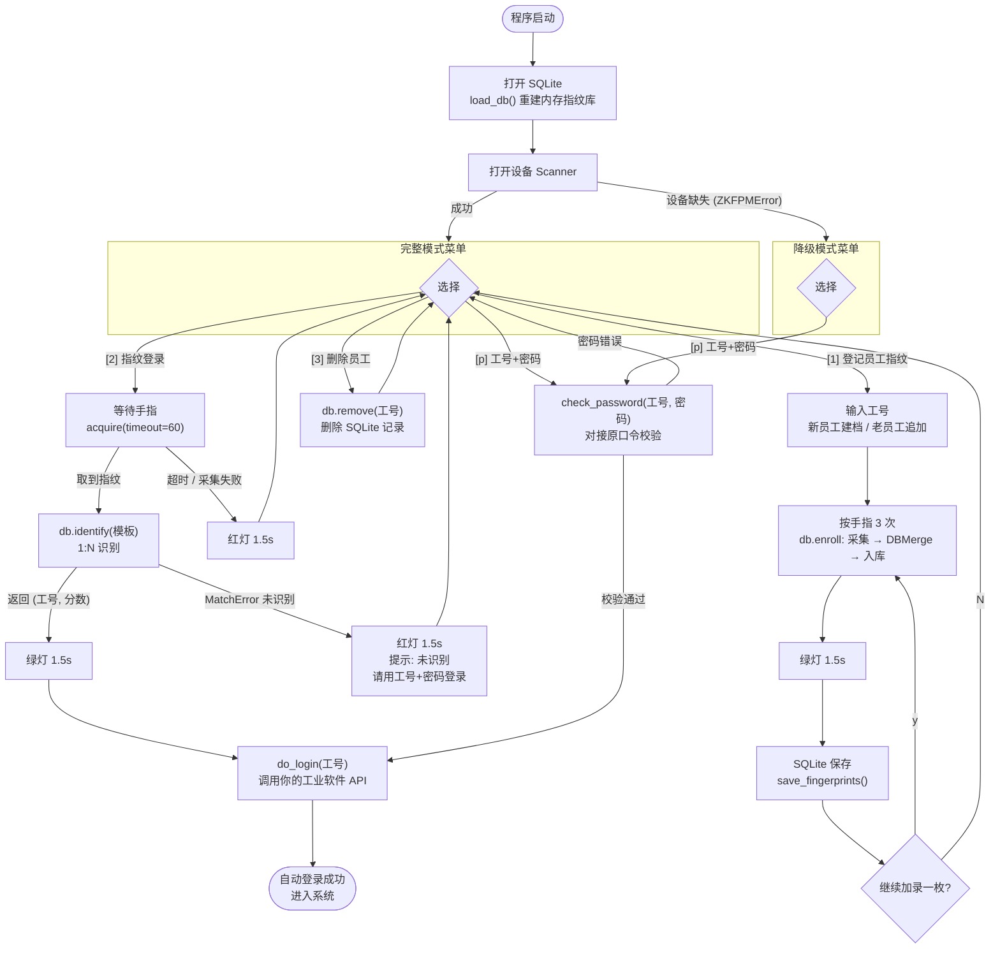
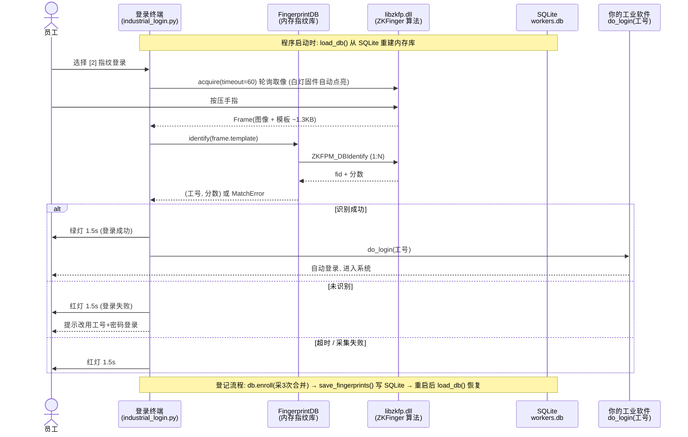

# pyzk20r

中控智慧 (ZKTeco / 熵基) **Live20R** 指纹采集器的 Python 库。

基于官方 [ZKFinger Reader SDK C API](https://www.zksps.com/productinfo/46887.html) 的纯 `ctypes` 封装:

- **零第三方依赖**, 纯标准库 (Python 3.4 例外: 自动附带官方 `typing` 移植包)
- 支持 **Windows XP / Python 3.4+** (单一代码库, 类型标注为 PEP 484:
  参数/返回内联标注 + typing 构造, 变量类型用注释)
- 使用驱动安装的系统 DLL (不捆绑分发, 见 DLL 查找顺序)
- 同步阻塞 + 生成器式持续采集; 无内部线程, 单线程使用; 方法粒度小, 便于子类覆写
- **一人多指纹** 模型: `user_id` 可登记多枚指纹, 识别直接返回用户

## 安装

```bash
pip install pyzk20r
```

> 目标机器必须安装 Live20R/SLK20R 的驱动 (libusb0 USB 驱动 + SDK 运行库)。驱动安装器会把
> libzkfp.dll 及其依赖链 (ZKFPCap.dll、zkfinger12.dll、ZKFPSensors\*.dll) 装进
> System32/SysWOW64, 本库直接加载系统副本 —— libzkfp.dll 的内部依赖按其自身所在目录解析,
> 单独拷贝一个 DLL 无法工作, 因此**本库不捆绑分发 DLL**。
> 也可用环境变量 `PYZK20R_DLL` 或 `Scanner(dll_path=...)` 显式指定 `libzkfp.dll` 路径。

## 快速上手

```python
from pyzk20r import FingerprintDB, MatchError, Scanner

db = FingerprintDB()
with Scanner() as dev:  # 构造即打开, 退出自动关闭
    print(dev.info())  # 厂商/产品名/序列号/VID&PID

    # 登记: 采 3 次自动合并入库 (同一工号可多次调用 = 多枚指纹)
    tpl = db.enroll(dev, user_id="1001")

    # 1:N 识别 -> (user_id, 分数)
    frame = dev.acquire()  # 阻塞等待一次按压
    uid, score = db.identify(frame.template)

    # 1:1 验证 -> 分数 (对该用户所有指纹取最优)
    score = db.verify("1001", dev.acquire().template)
```

持续采集 (生成器):

```python
with Scanner() as dev:
    for frame in dev.capture(poll_interval=0.1):  # 暂无手指时自动重试
        open("finger.bmp", "wb").write(frame.to_bmp())  # 图像存 BMP
        tpl = frame.template  # 提取好的模板
        break
```

## API 概览

### `Scanner(index=0, dll_path=None)` — 采集器

| 成员 | 说明 |
| --- | --- |
| `acquire(poll_interval=0.1, timeout=None)` | **阻塞等待手指**并采集一帧 → `Frame`; `timeout` 秒超时抛 `CaptureTimeoutError` (`CaptureError` 子类, 可区分"未按手指"与"取像故障"; `None` 为一直等) |
| `capture(poll_interval=0.1)` | 持续采集生成器, 逐帧 `yield Frame` (设备关闭后下一次迭代抛 `ZKFPMError`) |
| `acquire_image()` | 只取图像字节 |
| `enroll(poll_interval=0.1, timeout=None)` | 连续采集 3 次 (SDK 合并固定要求) 返回模板列表, 每次回调 `on_enroll_progress(done, total)`; 无人值守场景务必传 `timeout` |
| `width / height / dpi` (dpi 可写) | 图像规格; 儿童指纹建议 DPI 设 750/1000 |
| `fake_detect` (可读写) | 防假指纹开关 |
| `finger_is_live` | 最近一次采集是否真手指 (`value & 31 == 31`) |
| `info()` | `DeviceInfo(vendor, product, serial, vid_pid)` |
| `led('white'/'green'/'red', on)` | 指示灯 (参数码 101/102/103, **只写**; 实测 Live20R 三色可用; 读取这些只写参数会返回 -5, 属正常现象) |
| `template_format` (`'ansi'/'iso'`, 可读写) | 模板标准 |
| `template_quality(template)` | 模板质量分 |
| `device_ok` | 设备状态 |
| `open() / close()` / `with` | 生命周期, 可重复 close |

### `Frame` — 单次采集帧

`image` (原始灰度字节) / `template` (指纹模板) / `width / height / dpi` / `to_bmp()`

### `FingerprintDB(dll_path=None)` — 内存指纹库 (一人多指纹)

| 成员 | 说明 |
| --- | --- |
| `enroll(scanner, user_id, timeout=None)` | 完整登记: 采 3 次 → 合并 → 存入该用户名下 |
| `add(user_id, template)` | 直接添加一枚模板 (同一 user_id 可多次) |
| `identify(template)` | 1:N → `(user_id, score)`, 无匹配抛 `MatchError` |
| `verify(user_id, template)` | 1:1 → 最优分数, 不匹配抛 `MatchError` |
| `match(a, b)` | 两枚模板比对 → 分数 |
| `merge([t1, t2, t3])` | 3 枚采集模板合并为登记模板 |
| `remove(user_id[, template])` | 删除某用户的全部/指定指纹 |
| `clear() / count / users / fingers_of(user_id)` | 库管理 |
| `dump() / load(data)` | 持久化契约: 导出/重建 JSON 兼容结构 (存储介质与时机由应用层决定) |
| `threshold_1_1 / threshold_1_n` (可读写) | 比对阈值 (范围 0~1000, 越界直接拒绝); 默认值依机型而定, 实测 Live20R 为 45/60 |
| `extract_from_image(path, dpi=500)` | 从 BMP 提取模板 (仅 SDK 标准版) |

### 异常层级

```
ZKFPMError (含 .code 原始 SDK 错误码)
├── DeviceError
│   └── DeviceNotFoundError      # -3 无设备 / -6 打开失败
├── CaptureError                 # -8 取像失败等
│   └── CaptureTimeoutError      # 应用传入的 timeout 到点仍无手指
├── MatchError                   # -20 不匹配
├── MergeError                   # -22 合并失败
├── ExtractError                 # -9/-26/-27 图像提取失败
└── LibraryError                 # -1/-2/-17 库层失败
```

### 继承点

- `Scanner.on_enroll_progress(done, total)` — 登记进度钩子
- `Scanner.try_acquire(params=None)` — 采集前后的自定义处理 (如防假判定重试); 覆写请保留可选 `params` 参数 (v0.1.4 及之前为私有名 `_try_acquire`)
- `Scanner` / `FingerprintDB` 所有公开方法均可覆写

### 线程模型

本库是**同步设计**: 无内部线程。全局 Init/Terminate 引用计数有线程锁保护,
多线程**构造/关闭**设备与算法库是安全的; 但单个 `Scanner` / `FingerprintDB`
实例的操作仍不加锁——请勿多线程并发使用同一实例 (并发采集/比对),
需要后台采集请在承载线程内独占一个 `Scanner`。

### 安全提示

指纹模板是**生物特征识别数据**: `db.dump()` 导出的内容等同于生物凭据,
落盘时务必加密存储 (应用层加密 / BitLocker / 数据库透明加密) 并控制文件权限,
不要将明文模板随代码、日志或备份分发。`load()` 只做结构校验, 不验证来源。

### 持久化

内存指纹库**不自动落盘**, 进程退出即消失; 持久化由应用层用 `dump()/load()` 接入任意介质:

```python
import json

data = db.dump()  # {"version": 1, "templates": [[uid, "BASE64"], ...]}
json.dump(data, open("fingers.json", "w"))

db = FingerprintDB.load(json.load(open("fingers.json")))  # 启动时重建, 无需重新按手指
```

SQLite 存取完整示例见 `examples/persist.py`。

## 示例

| 脚本 | 用途 |
| --- | --- |
| `examples/capture.py` | 采集一帧指纹存 BMP |
| `examples/enroll_verify.py` | 登记 + 1:1 验证 |
| `examples/identify_1n.py` | 多人登记 + 1:N 识别循环 |
| `examples/persist.py` | 指纹 SQLite 持久化 |
| `examples/industrial_login.py` | **工业现场登录改造参考**: 登记工号指纹 -> 刷指纹自动登录 (含工号+密码兜底); 灯效反馈不支持时自动降级 |

## 登录场景流程 (industrial_login.py)



刷指纹自动登录时序:



> **灯效**: 图中的绿/红灯反馈在真机实测可用 (参数码 101 白 / 102 绿 /
> 103 红, 见 SDK 附录 1)。注意这些参数是**只写**的——读取它们会返回 -5
> (无效参数), 属正常现象, 不能用它判断灯效是否生效; 命令是否下发以
> 写入是否成功为准。个别机型若无灯效硬件, 写入可能仍成功但无灯光, 示例
> 对灯效失败做了容错降级 (转为纯文字提示), 不影响登录主流程。
> 待机/采集时的白灯同时是采像照明光源, 由固件自动点亮。
> 灯效与参数码可用 `scripts/diag_led.py` / `scripts/diag_params.py` 检测。

## DLL 查找顺序

1. `Scanner(dll_path=...)` / `FingerprintDB(dll_path=...)` 显式指定
2. 环境变量 `PYZK20R_DLL`
3. 系统副本 `C:\Windows\System32\libzkfp.dll` (32 位 Python 下经 WOW64 重定向即 SysWOW64;
   需先安装驱动, 完整依赖链在系统目录)
4. 兜底: 裸名 `libzkfp.dll` 交给 Windows 搜索 (PATH 中)

> 未安装许可文件 `zkfinger.lic` 时 SDK 会打印许可警告但功能可用 (算法 v12)。

## XP / Python 3.4 部署要点

- 目标机安装 **x86 版 Python** 与 Live20R/SLK20R USB 驱动
  (XP 最高只能装 3.4.4; Win7 最高 3.8 —— 均在支持范围内)
- Python 3.4 无内置 typing 模块: `pip install pyzk20r` 会自动带上官方
  `typing` 移植包 (声明的条件依赖 `typing; python_version < "3.5"`)
- wheel 纯 Python 无需编译。
  注意: 构建产物为 Metadata-Version 2.4, XP 上的老版 pip 若拒绝安装,
  先升级 pip (`python -m pip install -U "pip<20"`), 或直接把 wheel 当 zip
  解包进 site-packages (纯 Python 包, 解包即用)
- XP 下 `libzkfp.dll` 依赖系统 VC 运行库; 若加载报错, 安装 VC++ 2010/2013 运行库 (x86)
- 本库源码不含 f-string / 3.5+ 语法 (CI 有 ast 语法守卫测试)

## 开发

```bash
scripts\test_all.bat                              # 本地全量测试: 3.4 / 3.7 / 3.12 三版本
uv run python -m unittest discover -s tests -v   # 单版本快速跑 (默认跳过真机冒烟)
uv run ruff check .                              # lint
uvx ty check                                     # 类型检查 (ty 最低支持 3.7; 运行时兼容声明 3.4)
```

测试用标准库 `unittest`, 不需要安装任何第三方测试依赖; ruff/ty 用
`uvx` 隔离运行 (不受项目 Python 版本约束影响)。

服务端 CI 不做测试, 只保留 lint/构建与版本一致性检查; 测试一律在本地
(`scripts\test_all.bat`) 跑。加载真 DLL 的测试 (真机冒烟 + DLL 加载器) 默认关闭
——厂商 DLL 的跨进程退出状态不稳定, 连接设备后设 `PYZK20R_REAL_SMOKE=1`
开启; 该档在部分机器 (尤其 3.4 + 32 位) 上可能崩溃测试进程, 属厂商 DLL
已知不稳定, 不代表库本身有问题。

仓库采用 **src 布局** (`src/pyzk20r/`), 包源码不在仓库根目录, 避免与测试/示例混在一起:

```
src/pyzk20r/      库源码
tests/             单元测试 (FakeDLL 注入) + 真机冒烟 (默认关闭)
examples/          可运行示例
scripts/           版本号工具 (防止 tag 与版本号漂移)
doc/               厂商 SDK 文档 (不入库)
```

打包使用 uv 自家后端 (`uv_build`), 无需额外装 hatchling:

```bash
uv build                            # 生成 dist/*.whl 与 dist/*.tar.gz
uv build --wheel                    # 只出 wheel
```

产物校验: wheel 含 `pyzk20r/` 全部模块 + `py.typed` + `dist-info/licenses/LICENSE`;
sdist 额外含 `tests/` 与 `examples/`(指纹数据 `*.db` 自动排除)。

SDK 文档 (中英文 PDF + 头文件 + MFC Demo) 从 ZKTeco 官网 / "ZKFinger SDK" 安装包获取;
本库的接口注释即按其 C API 编写。

### 发版流程

版本号共出现在四处: `pyproject.toml` 的 `[project].version`、`src/pyzk20r/__init__.py`
的 `__version__`、`uv.lock` 的根包版本、git tag。**打 tag 前必须先改版本号**, 否则就是
版本漂移 (tag 指向的提交里版本号对不上, 发布流水线会直接失败)。

```bash
# 一条命令: 升版本号 (三处同步) + 提交版本文件 + 打 annotated tag
python scripts/version.py release 0.1.3

# 推送 (推 tag 即触发 GitHub Actions 发布 PyPI)
git push origin main && git push origin v0.1.3
git push gitee main && git push gitee v0.1.3
```

其它子命令:

```bash
python scripts/version.py check          # 校验四处一致 (CI 也跑这条)
python scripts/version.py bump 0.1.3      # 只升版本号, 不提交不打 tag
python scripts/version.py sync            # 把版本号同步为最新 tag 的版本
python scripts/version.py tag v0.1.3      # 校验通过后打 tag
```

CI 的 `version` job 与 `release` 工作流都会执行 `check`: 任何一处版本号对不上,
流水线直接失败, 不会带着漂移的版本发布到 PyPI。

## License

MIT (见 LICENSE)。ZKFinger SDK 及 `libzkfp.dll` 版权归 ZKTeco 所有, 需随官方驱动获取, 仅供配合其设备使用。
